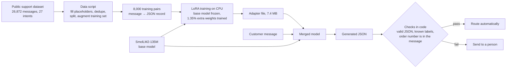

# Fine-tuning a small language model with LoRA

A 135-million-parameter open language model, fine-tuned on a CPU to read a customer support
message and write a routing record:

```json
{"category": "REFUND", "intent": "get_refund", "order_number": "PX300127"}
```

The project measures the fine-tuned model against the same model driven by prompts only and
against a classic classifier, on the same messages. It is for teams who want a small model they
own and run themselves, and who want to know **when fine-tuning is worth it** before paying for it.

## What the measurements show

| System | Intent correct | Whole record correct | Intent correct on new wording |
|---|---|---|---|
| Base model, instructions only | 0.0% | 0.0% | 0.0% |
| Base model, instructions + 8 examples | 12.0% | 8.0% | 16.7% |
| **Fine-tuned with LoRA** | **97.6%** | **97.4%** | 66.7% |
| Classic classifier + regular expression | 99.1% | 95.5% | 73.3% |

Three plain conclusions:

1. **Fine-tuning is what makes the small model usable.** Out of the box it cannot do the task: with
   instructions only it never wrote a usable record, and with worked examples in the prompt it got
   12 intents in 100 right. After 43 minutes of LoRA training on a CPU it gets 97.6%.
2. **On the whole record the fine-tuned model is ahead of the classic approach** (97.4% against
   95.5% on 1,000 held-out messages), because it copies the order number in context while a regular
   expression also picks up numbers that are not order numbers (4.0% of messages with no order
   number got one invented, against 0.2% for the fine-tuned model).
3. **For the label alone, a classic classifier is still as good or better**, trains in seconds and
   answers in microseconds. On 60 messages I wrote by hand in a different style it got 44 intents
   right and the fine-tuned model 40. A model this small does not handle unfamiliar wording
   better than word statistics do. If all you need is a label, do not fine-tune a language model.

## How it works



- **LoRA** leaves all 134.5 million original weights frozen and trains 1.84 million extra ones
  (1.35%) placed beside the attention layers. The result is a 7.4 MB file instead of a second copy
  of the model.
- **Only the answer is trained.** The message part of each example is masked out of the loss, so
  the model learns to write the record and not to write customer messages.
- **The output is never trusted as is.** Code checks that it is valid JSON, that the labels are on
  the approved list, that the intent belongs to the category, and that the order number literally
  appears in the message. A record that fails goes to a person.

## Real output

From the running API (`python -m triage.cli serve`), fine-tuned model on a CPU:

```
POST /route {"message": "The kettle arrived broken. I want my money back for order PX300127."}
{"category":"REFUND","intent":"get_refund","order_number":"PX300127","needs_review":false,"problems":[],"provider":"lora","latency_ms":1375}

POST /route {"message": "locked out, forgot the pasword, need a reset link pls"}
{"category":"ACCOUNT","intent":"recover_password","order_number":null,"needs_review":false,"problems":[],"provider":"lora","latency_ms":1192}

POST /route {"message": "My phone is 555 0142 if you need it. I just want to know where order ORD-31880 is."}
{"category":"ORDER","intent":"track_order","order_number":"ORD-31880","needs_review":false,"problems":[],"provider":"lora","latency_ms":1484}
```

And one it gets wrong, which the checks cannot catch because the record is well formed:

```
POST /route {"message": "What is the weather like in Paris tomorrow?"}
{"category":"DELIVERY","intent":"delivery_period","order_number":null,"needs_review":false, ...}
```

The label list has no "none of these", so an off-topic message is forced into the nearest label.
See [Limits](#limits).

What the same base model writes before fine-tuning, with instructions only:

```
"I'm sorry for any misunderstanding, but as an AI, I don't have the ability to access or process sensitive information..."
```

## Results

All numbers come from `python -m evals.run` and are stored in [`evals/report.json`](evals/report.json)
with sample outputs of every system. `python -m evals.table` prints these tables.

**Held-out test set** (messages from the public dataset that were not used for training)

| System | Messages | Valid record | Intent correct | Order number correct | Whole record correct | ms per message |
|---|---|---|---|---|---|---|
| Base model, instructions only | 100 | 0.0% | 0.0% | 0.0% | 0.0% | 907.21 |
| Base model, instructions + 8 examples | 100 | 100.0% | 12.0% | 90.0% | 8.0% | 1661.28 |
| Fine-tuned with LoRA | 1000 | 99.9% | 97.6% | 99.6% | 97.4% | 187.75 |
| Classic classifier + regex | 1000 | 100.0% | 99.1% | 96.4% | 95.5% | 0.03 |
| Offline keyword rules (test stand-in) | 1000 | 100.0% | 52.3% | 96.4% | 50.2% | 0.03 |

**Hand-written set** (60 messages written for this project in a different style, [`evals/challenge.jsonl`](evals/challenge.jsonl))

| System | Messages | Valid record | Intent correct | Order number correct | Whole record correct | ms per message |
|---|---|---|---|---|---|---|
| Base model, instructions only | 60 | 0.0% | 0.0% | 0.0% | 0.0% | 915.27 |
| Base model, instructions + 8 examples | 60 | 98.3% | 16.7% | 70.0% | 1.7% | 1690.11 |
| Fine-tuned with LoRA | 60 | 100.0% | 66.7% | 98.3% | 65.0% | 214.1 |
| Classic classifier + regex | 60 | 100.0% | 73.3% | 98.3% | 71.7% | 0.18 |
| Offline keyword rules (test stand-in) | 60 | 100.0% | 70.0% | 98.3% | 68.3% | 0.13 |

Notes on reading the tables:

- "ms per message" is measured in batches of 16 (8 for the long prompt with examples). One message
  at a time, the way the API is called, the fine-tuned model takes a median of 1,059 ms and 1,325 ms
  at the 95th percentile (`python -m evals.latency`, 40 messages, 4 CPU threads on a machine that
  was running other work).
- The two base-model rows on the test set use the first 100 messages, because each message takes
  one to two seconds. The other rows use all 1,000.
- "Order number correct" counts a message with no order number as correct when the system
  answers `null`, so a system that never finds a number still scores high. On the 93 test messages
  that do contain one, the fine-tuned model found 97.8% and the regular expression 100%; the
  difference is in the numbers the regular expression should not have picked up.
- The keyword rules are the offline stand-in used by the tests. I wrote both the rules and the
  hand-written set, so their 70% on that set flatters them; on the test set they get 52.3%.
- 60 messages is a small set: the gap between 40 and 44 correct is four messages.

### What two training runs taught

| | Run 1 | Run 2 (the one in `adapter/`) |
|---|---|---|
| Training data | 4,000 pairs as the dataset gives them | 8,000 pairs, with order-number mentions and unrelated numbers added to some |
| Steps, time on CPU | 250, 20.5 min | 500, 42.9 min |
| Validation loss, before → after | 2.8174 → 0.0135 | 2.8174 → 0.0063 |
| Test: intent correct | 95.7% | 97.6% |
| Hand-written: intent correct | 53.3% | 66.7% |
| Hand-written: order numbers found | 56.2% | 93.8% |

In the source dataset an order number appears only inside a few intents (cancel, change, track),
so run 1 learned "these intents have a number" instead of "copy the number", and missed it in a
complaint or an invoice request. Adding order numbers to messages of every intent in the training
set fixed that. The lesson for a client project: most of the gain came from fixing the data, not
from the training settings. Run 1 files are kept in [`evals/history/`](evals/history).

## Quick start

No API key is needed for anything below.

```bash
git clone <this repo> && cd small-llm-lora-finetune
python3 -m venv .venv && .venv/bin/pip install -r requirements.txt

# 1. Tests: offline, no model download (they train LoRA on a tiny model built in memory)
.venv/bin/pytest -q

# 2. Route a message with the offline keyword rules (instant, nothing downloaded)
TRIAGE_PROVIDER=mock .venv/bin/python -m triage.cli route "Please cancel order ORD-12345"

# 3. Route a message with the fine-tuned model (downloads the base model once, about 260 MB)
.venv/bin/python -m triage.cli route "The kettle arrived broken. I want my money back for order PX300127."

# 4. The API, with interactive documentation at http://127.0.0.1:8540/docs
.venv/bin/python -m triage.cli serve

# 5. Reproduce the numbers
.venv/bin/python -m triage.cli data                                       # download the dataset, write the splits
.venv/bin/python -m evals.run --systems classic lora mock --set test
.venv/bin/python -m evals.run --systems classic lora mock --set challenge
.venv/bin/python -m evals.run --systems base-prompt base-examples --set test --limit 100
.venv/bin/python -m evals.table

# 6. Train the add-on again (about 45 minutes on 4 CPU threads)
.venv/bin/python -m triage.cli train
```

## Configuration

Copy `.env.example` and export the values, or set them in the shell.

| Variable | Default | Meaning |
|---|---|---|
| `TRIAGE_PROVIDER` | `local` | `local` = the fine-tuned model, `mock` = offline keyword rules, `openai` = a hosted model with the same instructions |
| `TRIAGE_BASE_MODEL` | `HuggingFaceTB/SmolLM2-135M-Instruct` | The base model the add-on belongs to |
| `TRIAGE_ADAPTER_DIR` | `adapter` | Folder with the trained LoRA add-on |
| `TRIAGE_THREADS` | `0` | CPU threads for PyTorch (0 = PyTorch decides) |
| `OPENAI_API_KEY`, `OPENAI_MODEL` | empty | Only for the optional hosted comparison (`--systems hosted`) |

Training settings (`python -m triage.cli train --help`): rank 16, alpha 32, dropout 0.05, on the
query, key, value and output projections of every attention layer; batch 16, learning rate 5e-4
with 30 warm-up steps and cosine decay, one pass over 8,000 examples.

## Project structure

```
triage/
  train.py       LoRA fine-tuning loop (start here)
  data.py        public dataset → message/JSON pairs: placeholders, dedupe, split, augmentation
  schema.py      the record and the checks that decide if it can be trusted
  labels.py      the approved 11 categories and 27 intents
  prompts.py     short prompt for the fine-tuned model, full instructions for an untrained one
  model.py       load base model ± add-on, merge, batched CPU generation
  providers.py   offline rules, local model, optional hosted model
  baseline.py    TF-IDF + logistic regression + regular expression
  metrics.py     one scorer for every system
  service.py     route one message, set the review flag
  api.py         FastAPI app            cli.py   data | train | route | serve
adapter/         the trained add-on (7.4 MB) and training_log.json
evals/           run.py, latency.py, table.py, challenge.jsonl, report.json, history/
tests/           53 tests, offline
```

## Limits

- **Classic classifier wins on the label.** For intent alone it scores higher on both sets, and
  it is thousands of times faster. The fine-tuned model is only ahead on the whole record.
- **New wording is the weak point.** 66.7% of intents on the hand-written set against 97.6% on
  the test set. The public dataset was generated from templates, so held-out messages resemble
  training messages and test scores flatter every trained system.
- **The hand-written set is small and not fully blind.** It has 60 messages, written by the
  author. The training-data change in run 2 was made after seeing run 1's result on it, so the
  order-number figure on that set (93.8%) is partly the result of tuning towards it.
- **No "none of these" label.** An off-topic message is routed to the nearest intent and the checks
  do not catch it. A real deployment needs an "other" class and examples for it.
- **One order number per message**, and only the order number is extracted. The dataset's other
  values (names, amounts, cities) are invented fillers.
- **Speed.** About one second per message one at a time on a shared 4-thread CPU. That is fine
  for routing tickets in the background, not for typing-speed interaction. No quantisation or
  ONNX export was done.
- **One training run per setting, one seed.** No search over rank or learning rate, and no
  confidence intervals.
- **Hosted model not measured.** The code path for a hosted comparison exists and is tested with
  a stand-in client, but no API key was available during the build, so there is no number for it.
- **English only**, and the dataset contains some rude wording, as real support messages do.

## Data and licences

- Code: MIT, see [LICENSE](LICENSE).
- Base model: [SmolLM2-135M-Instruct](https://huggingface.co/HuggingFaceTB/SmolLM2-135M-Instruct), Apache 2.0.
- Training data: [Bitext customer support dataset](https://huggingface.co/datasets/bitext/Bitext-customer-support-llm-chatbot-training-dataset),
  CDLA-Sharing-1.0. It is downloaded by the data script and is not stored in this repository.
